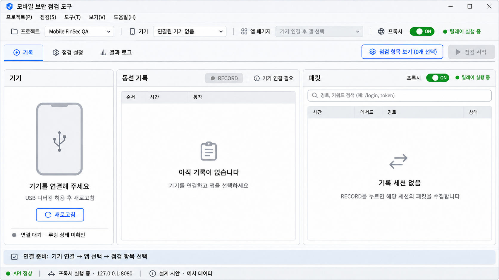
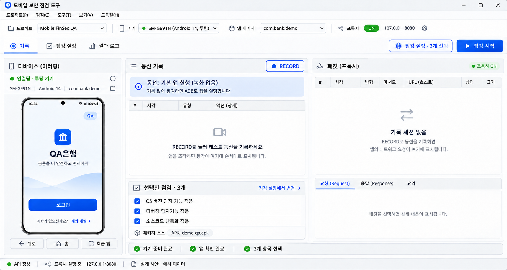
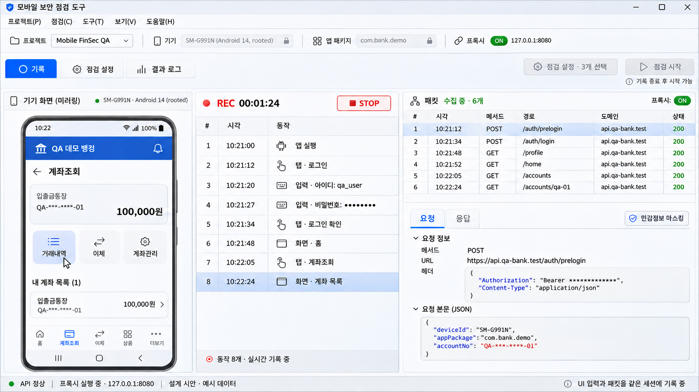
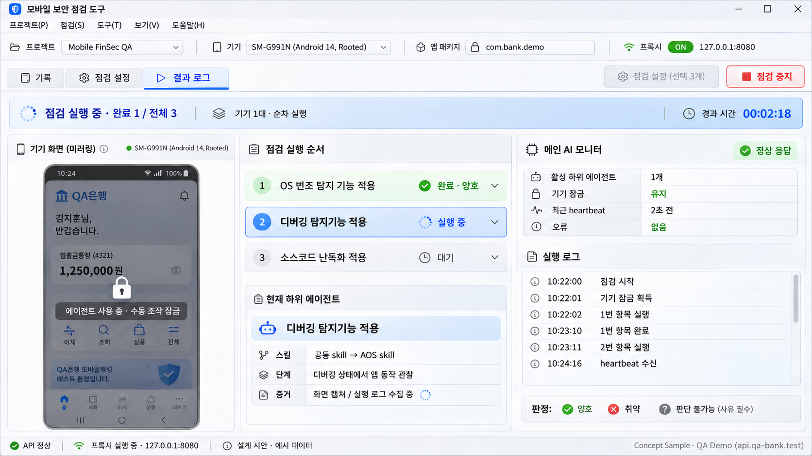
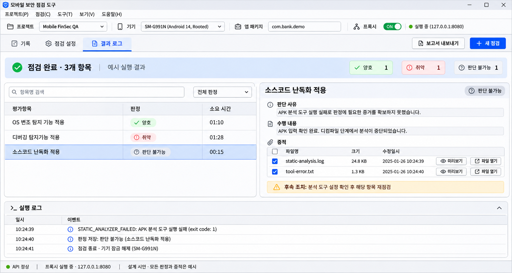

# UI 검토용 시안 v2

AI로 생성한 **개념 목업**이며 실제 GPUI 구현 화면이나 점검 결과가 아닙니다. 앱·계정·금액·패킷·증적·시간은 예시입니다. 화면 구성과 상태 전이를 검토하기 위한 자료이며, 최종 승인된 픽셀 명세를 뜻하지 않습니다.

각 이미지는 독립된 전체 화면입니다. 클릭하면 원본 크기로 볼 수 있습니다.

|상태|이미지|핵심 검토 내용|
|---|---|---|
|기기 미연결|[01-device-disconnected.png](01-device-disconnected.png)|연결 안내, 비활성 RECORD/점검 시작, relay 상태와 기록 세션 구분|
|기록 전 준비|[02-ready-before-record.png](02-ready-before-record.png)|기기·앱·항목 선택, 기록 없는 기본 앱 실행 동선|
|기록 중|[03-recording.png](03-recording.png)|기기/앱 잠금, STOP, UI 입력과 packet 동시 기록|
|점검 실행 중|[04-scan-running.png](04-scan-running.png)|기기 한 대 순차 실행, main AI 감시, 활성 agent, 실행 로그|
|결과 로그|[05-result-log.png](05-result-log.png)|양호/취약/판단 불가능, 이유·증적·오류 및 후속 조치|

## 구현 시 우선하는 명세와 시안 차이

- 점검 실행 중에는 기기·앱 선택을 잠근다. 04번의 기기 selectbox가 활성처럼 보이는 것은 그림의 미반영 사항이며 실제로 변경을 허용한다는 의미가 아니다. 수동 기기 조작도 실행 소유권과 충돌하지 않게 제어한다.
- 기록 중에는 점검 시작을 비활성화한다. 점검 중 STOP/취소는 즉시 잠금 해제가 아니라 진행 도구 종료와 정리 완료를 기다리는 흐름이다.
- 일부 그림의 'OS 변전 탐지' 문구는 'OS 변조 탐지'로 수정해야 한다. 생성 이미지의 오탈자는 평가항목 명칭 변경이 아니다.
- 01번의 proxy 토글 중복 배치, 화면별 아이콘·용어·버튼 스타일 차이는 디자인 정리 대상이다. 두 개의 독립 proxy를 뜻하지 않는다.
- 05번 증적의 날짜 등은 예시이며 실제 실행 시각을 뜻하지 않는다. '점검 완료'와 개별 도구 오류/판단 불가능을 함께 보여주는 시안이다.
- 04번에서 루팅 기기의 앱 화면과 양호 예시가 함께 보인다고 해당 상태만으로 양호를 판정하지 않는다. 실제 판정은 항목별 절차와 증적에 따른다.
- proxy ON은 relay 실행 상태이다. RECORD의 packet 수집 범위와는 구분한다. STOP/OFF 시 진행 중 요청 처리 정책은 구현 전 확정한다.
- 예시의 포트 8080, 모델명, 항목 개수, 경과 시간 및 보고서 내보내기 UI는 확정된 구현 수치나 완료 기능이 아니다.

상태·기능 요구사항은 [화면 흐름](../03-ui-flow.md), [구조](../02-architecture.md), [PoC 계획](../07-poc-plan.md)을 우선한다. 이미지의 작은 오류를 기능 결정으로 해석하지 않는다.

## 전체 화면

### 1. 기기 미연결

### 2. 기록 전 준비

### 3. 기록 중

### 4. 점검 실행 중

### 5. 결과 로그
