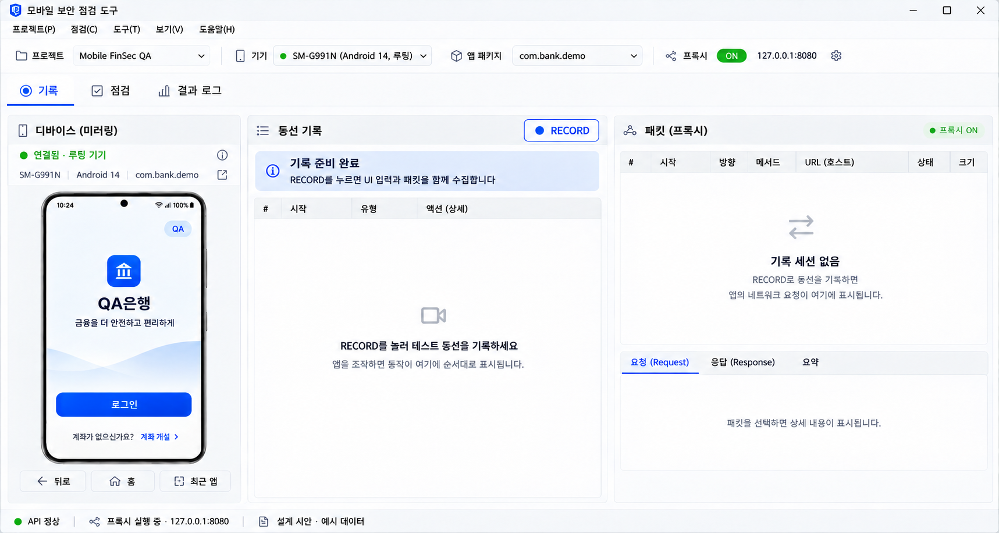
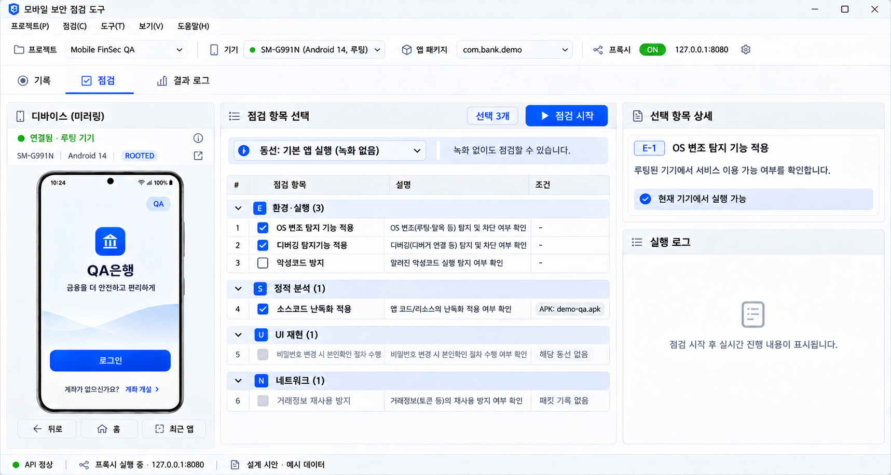
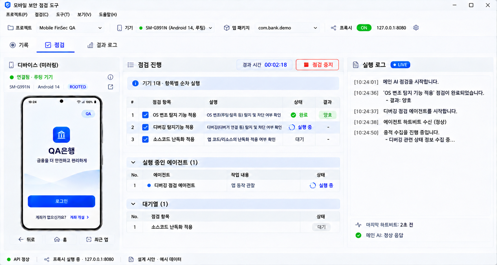
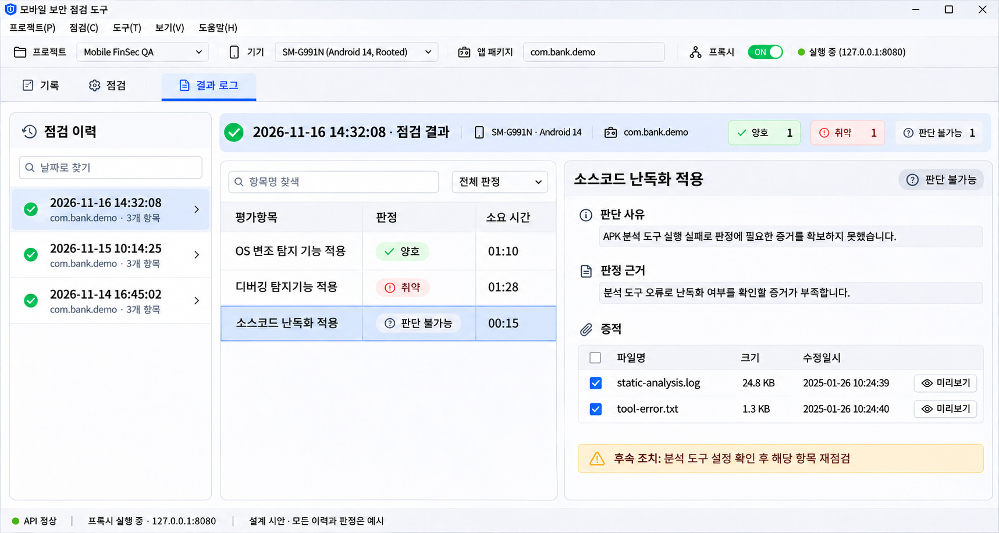

# 승인된 UI 시안

사용자가 승인한 기록·점검 화면 **v4 5장**과 최종 결과 이력 화면 **v5 1장**이다. 기존 v2 시안은 현재 폴더에서 대체했으며 Git 이력에서 확인할 수 있다.

AI 생성 개념 이미지이며 실제 실행 화면/검사 결과가 아니다. 이미지의 승인된 구조는 [화면 명세](../03-ui-flow.md)에 반영했다.

|번호|화면|파일|
|---|---|---|
|01|기기 미연결, 기록 탭|[원본](01-device-disconnected.png)|
|02|기록 준비|[원본](02-record-ready.png)|
|03|기록 중|[원본](03-recording.png)|
|04|점검 항목 선택|[원본](04-check-selection.png)|
|05|점검 실행 중|[원본](05-check-running.png)|
|06|날짜·시각별 최종 결과 이력|[원본](06-final-results-history.png)|

## 승인된 역할 분리

- 기록: 동선과 packet 기록만. 점검 checkbox/선택 요약/시작 버튼 없음.
- 점검: 선택과 실시간 진행을 같은 탭에서 제공. 기기 왼쪽, 항목/agent/대기열 가운데, 실시간 로그 오른쪽.
- 결과 로그: 완료된 실행의 최종 결과. 왼쪽에서 날짜·시각별 실행을 선택.
- 자물쇠/수동 조작 잠금 overlay와 마스킹 UI, 모호한 '점검 항목 보기' 버튼 제거.
- 내부의 단일 기기 순차 실행 원칙은 그대로 유지.

## 예시와 남은 정리

앱 이름, 계정·암호·token·금액·packet·주소·증적·시간은 모두 합성 예시다. 실제 비밀값 공개/외부 전송의 승인이 아니다. 'OS 변조 탐지' 등 공식 항목명은 텍스트 명세를 따른다. 중복 proxy 표시, 일부 폰트/문구 차이 및 06번 증적 날짜와 실행 날짜의 불일치는 구현 시 정리한다. 8080 포트나 예시 항목 개수는 고정 요구사항이 아니다.

### 01 · 기기 미연결

### 02 · 기록 준비

### 03 · 기록 중

### 04 · 점검 항목 선택

### 05 · 점검 실행 중

### 06 · 최종 결과 이력
